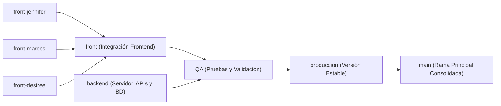

# 📘 VibeEnglish — Plataforma Interactiva de Aprendizaje de Inglés

Bienvenido al repositorio oficial y privado de **VibeEnglish**, una plataforma web interactiva diseñada para el aprendizaje progresivo del idioma inglés por niveles y unidades.

> **🔒 Repositorio Privado Oficial:** https://github.com/jennvallejo1-glitch/VibeEnglish  
> **🌐 Aplicación Frontend Desplegada (Vista en Vivo):** https://vibeenglish-paso-a-paso.netlify.app

---

## 1. Descripción General del Proyecto

**VibeEnglish** es una aplicación educativa moderna orientada a estudiantes de habla hispana que desean aprender y practicar inglés de manera estructurada e interactiva.

La plataforma cuenta con una arquitectura **Frontend** completa desarrollada originalmente por **Jennifer Suazo**, que incluye:
- **Flujo de Acceso y Suscripción**: Pantalla inicial de bienvenida, registro de usuarios, inicio de sesión, recuperación de contraseña, selección/gestión de planes de suscripción (Mensual, Trimestral y Anual) y barra de sesión activa.
- **Navegación y Estructura Académica**: Pantalla de inicio con accesos rápidos, **Guía de Unidades** (6 Unidades × 6 Lecciones = 36 tarjetas de lecciones estructuradas) y acceso a los **3 niveles de inglés** (*Principiante*, *Intermedio* y *Avanzado*).
- **Módulos de Aprendizaje y Práctica**: *Manual de uso*, *Laboratorio de Audio*, *Conversación*, *Pronunciación*, *Foro de estudiantes*, *Mi progreso* y *Mis logros* (con certificados por nivel).
- **Personalización Visual**: Sistema de 3 temas visuales integrados (*Claro*, *Oscuro* y *Colorido*) y diseño adaptable a computadoras, tabletas y teléfonos móviles.

---

## 2. Objetivos y Alcance del Proyecto

### 🎯 Objetivo General
Construir e integrar una plataforma web completa de aprendizaje de inglés que combine la interfaz visual interactiva existente (**Frontend**) con servicios de servidor, base de datos, autenticación, evaluación de audio/pronunciación y seguimiento académico (**Backend**), validada mediante pruebas de calidad (**QA**) y desplegada en un entorno estable (**Producción**).

### 📌 Alcance del Proyecto
1. **Conservar intacto el diseño y la estructura visual del Frontend existente**, distribuyendo las mejoras funcionales por módulos sin duplicar esfuerzos ni alterar la línea gráfica original.
2. **Desarrollar e integrar el Backend** para proveer autenticación real, gestión de suscripciones, entrega dinámica de lecciones/ejercicios, persistencia del foro, seguimiento de progreso y generación de certificados.
3. **Integrar servicios multimedia e interactivos** para reproducción de audio, grabación de voz, evaluación de pronunciación y práctica de conversación.
4. **Validar la calidad del software en la rama `QA`** antes de promover cambios hacia **`produccion`** y **`main`**.

---

## 3. Tecnologías Utilizadas

| Capa / Área | Tecnologías y Herramientas |
| :--- | :--- |
| **Frontend** | HTML5 Semántico (`index.html`), CSS3 Avanzado con Variables CSS, Flexbox, Grid y 3 Temas (`styles.css`), JavaScript Vanilla ES6+ (`app.js`). |
| **Servidor Local** | Node.js (`server.js` con módulos nativos `http`, `fs`, `path` en puerto `3000`). |
| **Backend (En integración)** | Node.js, APIs REST, Autenticación JWT / `bcrypt`, Base de Datos para usuarios, lecciones, foro y progreso, Web Speech API / `MediaRecorder` y servicios de IA/TTS. |
| **Control de Versiones** | Git y GitHub (Repositorio privado con flujo de ramas por equipos y Pull Requests). |
| **Despliegue y Hosting** | Netlify (`netlify.toml`, publicación desde `public/`). |

---

## 4. Organización de Ramas del Repositorio

El repositorio cuenta con **ramas reales de Git** organizadas según el rol de cada equipo:

| Rama | Propósito y Alcance | Equipo Responsable |
| :--- | :--- | :--- |
| **`main`** | **Rama principal y de coordinación general.** Contiene el `README.md` general, la documentación del proyecto, los objetivos, la distribución de roles y la versión consolidada del proyecto. | Coordinación General (`Jennifer Suazo`) |
| **`front`** | **Rama principal de Frontend.** Conserva intacto el frontend desarrollado originalmente y concentra la integración de los módulos del equipo de interfaz visual. | Equipo Frontend (`Jennifer`, `Marcos`, `Desiree`) |
| **`front-jennifer`** | Sub-rama de trabajo individual de Frontend para **Inicio, navegación, dashboard, niveles y guías de unidades**. | Jennifer (`@jennvallejo1-glitch`) |
| **`front-marcos`** | Sub-rama de trabajo individual de Frontend para **Lecciones, manual teórico, vocabulario, ejercicios, listening y evaluaciones**. | Marcos (`@Marcosivan002`) |
| **`front-desiree`** | Sub-rama de trabajo individual de Frontend para **Audio, pronunciación, conversación, foro, progreso, historial y perfil**. | Desiree (`@genesisguzman-dev`) |
| **`backend`** | **Rama de Backend.** Destinada al desarrollo del servidor, endpoints de la API, lógica de negocio, autenticación, pagos y base de datos. | Equipo Backend |
| **`QA`** | **Rama de Control de Calidad.** Destinada a pruebas funcionales, validación de integración entre `front` y `backend`, reporte de errores y aseguramiento de calidad. | Equipo QA |
| **`produccion`** | **Rama de Producción.** Destinada a la integración y preparación de versiones estables listas para su publicación final en el entorno en vivo. | Equipo de Producción |

---

## 5. Distribución de Responsabilidades por Equipo

### 🎨 5.1 Distribución del Equipo Frontend (Rama base: `front`)

El equipo de Frontend está integrado por **Jennifer**, **Marcos** y **Desiree**, dividiendo el trabajo por módulos funcionales para trabajar de forma ordenada sobre la rama `front` sin duplicar tareas ni rehacer las pantallas que ya existen:

| Área del Frontend | Responsable | Rama de Trabajo |
| :--- | :--- | :--- |
| Inicio y dashboard | **Jennifer** | `front-jennifer` |
| Navegación y selección de niveles | **Jennifer** | `front-jennifer` |
| Módulos y guías de unidades | **Jennifer** | `front-jennifer` |
| Diseño de las tarjetas y estructura visual compartida | **Jennifer** | `front-jennifer` |
| Manual y teoría | **Marcos** | `front-marcos` |
| Lecciones y vocabulario | **Marcos** | `front-marcos` |
| Ejercicios y actividades | **Marcos** | `front-marcos` |
| Listening y evaluaciones | **Marcos** | `front-marcos` |
| Resultados de los exámenes | **Marcos** | `front-marcos` |
| Grabación y reproducción de audio | **Desiree** | `front-desiree` |
| Speaking y pronunciación | **Desiree** | `front-desiree` |
| Conversación con IA | **Desiree** | `front-desiree` |
| Foro | **Desiree** | `front-desiree` |
| Progreso, historial y perfil | **Desiree** | `front-desiree` |

---

#### 👤 1. Jennifer (`@jennvallejo1-glitch`) — *Interfaz principal y navegación* (`front-jennifer`)
Responsable de la estructura general y de la experiencia visual de la plataforma.

- **Módulos asignados:**
  - Pantalla de inicio y dashboard.
  - Menú lateral o barra de navegación.
  - Navegación entre las diferentes secciones.
  - Selección de niveles: principiante, intermedio y avanzado.
  - Pantallas de módulos y guías de unidades.
  - Diseño de las tarjetas de cursos y lecciones.
  - Barras de progreso visuales.
  - Diseño adaptable a computadoras, tabletas y móviles.
  - Integración visual de los componentes compartidos.
- **Botones y funciones:**
  - *Inicio*, *Comenzar a aprender*, *Continuar última lección*, *Seleccionar nivel*, *Abrir módulo*, *Abrir guía de unidad*, *Siguiente lección y lección anterior*, *Volver al menú principal*.

---

#### 👤 2. Marcos (`@Marcosivan002`) — *Lecciones y actividades educativas* (`front-marcos`)
Responsable de las interfaces donde el estudiante aprende, escucha, lee y practica inglés.

- **Módulos asignados:**
  - Pantalla de contenido de cada lección.
  - Manual o material teórico de inglés.
  - Guías de estudio por unidad.
  - Vocabulario con traducciones y ejemplos.
  - Ejercicios de gramática.
  - Ejercicios de selección múltiple.
  - Actividades para completar oraciones.
  - Ejercicios de relacionar y ordenar palabras.
  - Comprensión auditiva (*Listening*).
  - Evaluaciones por lección y módulo.
  - Pantalla de resultados y revisión de errores.
  - Diccionario y palabras favoritas (si forman parte del alcance).
- **Botones y funciones:**
  - *Abrir manual*, *Ver teoría y ejemplos*, *Escuchar audio*, *Mostrar traducción*, *Comenzar ejercicio*, *Comprobar respuesta*, *Ver explicación*, *Intentar nuevamente*, *Siguiente pregunta*, *Finalizar evaluación*, *Ver calificación*, *Revisar errores*.

---

#### 👤 3. Desiree (`@genesisguzman-dev`) — *Audio, pronunciación y comunicación* (`front-desiree`)
Responsable de las interfaces de práctica oral y de las funciones complementarias del estudiante.

- **Módulos asignados:**
  - Pantalla de práctica de pronunciación.
  - Interfaz de grabación y reproducción de voz.
  - Módulo de conversación en inglés.
  - Interfaz de conversación con IA (si está contemplada).
  - Actividades de expresión oral (*Speaking*).
  - Foro de estudiantes.
  - Pantalla de progreso individual.
  - Historial de actividades y calificaciones.
  - Perfil del estudiante y configuración.
  - Pantallas de logros e insignias.
  - Estados de carga, errores y permisos del micrófono.
- **Botones y funciones:**
  - *Grabar audio*, *Detener grabación*, *Reproducir mi voz*, *Escuchar pronunciación correcta*, *Evaluar pronunciación*, *Intentar nuevamente*, *Iniciar conversación*, *Enviar mensaje*, *Finalizar conversación*, *Publicar en el foro*, *Ver mi progreso*, *Consultar historial*, *Editar perfil*.

> **Nota importante sobre el alcance de Frontend:** Como el frontend base ya está desarrollado, **no se deben volver a crear desde cero ni eliminar las pantallas existentes**; el equipo se reparte las funcionalidades pendientes, los ajustes y el mantenimiento. Asimismo, la grabación real, la evaluación fonética de pronunciación y la conversación con IA requieren conexión con servicios de Backend/APIs externas.

---

### ⚙️ 5.2 Equipos de Backend, QA, Producción y Coordinación General

| Área / Equipo | Rama Principal | Responsabilidades Clave |
| :--- | :--- | :--- |
| **Coordinación General** | `main` | Supervisión de la arquitectura general, aprobación de fusiones finales, mantenimiento de la documentación maestra y control de acceso al repositorio. |
| **Equipo Frontend** | `front` (`front-jennifer`, `front-marcos`, `front-desiree`) | Mantenimiento de la interfaz visual existente y conexión de eventos de UI por módulos asignados sin alterar el diseño base. |
| **Equipo Backend** | `backend` | Construcción del servidor, base de datos, autenticación (`login`, `register`, `recover`), pasarela de suscripciones, API de lecciones/evaluaciones, servicios de audio/pronunciación, persistencia del foro y certificados. |
| **Equipo QA (Calidad)** | `QA` | Ejecución de planes de prueba funcionales, validación de formularios, pruebas multi-dispositivo, verificación de integración Frontend-Backend y reporte de incidencias. |
| **Equipo Producción** | `produccion` | Preparación de versiones estables (*releases*), verificación de variables de entorno seguras, control del despliegue en Netlify/servidor y monitoreo en vivo. |

### 👥 Directorio de Colaboradores Autorizados en el Repositorio Privado

| Nombre | Usuario de GitHub | Correo Institucional |
| :--- | :--- | :--- |
| **Jennifer Suazo** *(Propietaria / Coordinación y Frontend)* | `@jennvallejo1-glitch` | `jennifer.suazo3@ujcv.edu.hn` |
| **Marcos Flores** *(Frontend — `front-marcos`)* | `@Marcosivan002` | `marcos.flores2@ujcv.edu.hn` |
| **Desiree / Génesis Guzmán** *(Frontend — `front-desiree`)* | `@genesisguzman-dev` | `genesis.guzman@ujcv.edu.hn` |
| **Mariela Mejía** *(Colaboradora del Proyecto)* | `@marielamejia-a11y` | `mariela.mejia@ujcv.edu.hn` |
| **Tania Zepeda** *(Colaboradora del Proyecto)* | `@LadyTani7` | `tania.zepeda@ujcv.edu.hn` |
| **Enmanuel Fajardo** *(Colaborador del Proyecto)* | `@fajardo21` | `enmanuel.fajardo@ujcv.edu.hn` |
| **Oscar Azarel Torres Salinas** *(Colaborador del Proyecto)* | `@Azareltorres15` | `oscar.torres5@ujcv.edu.hn` |

---

## 6. Instrucciones para Clonar el Repositorio y Cambiar de Rama

### Paso 1: Clonar el repositorio privado
Abrí tu terminal (Git Bash, PowerShell o CMD) y ejecutá:

```bash
git clone https://github.com/jennvallejo1-glitch/VibeEnglish.git
cd VibeEnglish
```

### Paso 2: Descargar todas las ramas remotas
```bash
git fetch --all
```

### Paso 3: Cambiar a la rama que corresponde a tu rol

- **Para el equipo de Frontend (rama integradora de Frontend):**
  ```bash
  git checkout front
  ```
  - **Rama individual de Jennifer:**
    ```bash
    git checkout front-jennifer
    ```
  - **Rama individual de Marcos:**
    ```bash
    git checkout front-marcos
    ```
  - **Rama individual de Desiree:**
    ```bash
    git checkout front-desiree
    ```

- **Para el equipo de Backend:**
  ```bash
  git checkout backend
  ```

- **Para el equipo de Control de Calidad (QA):**
  ```bash
  git checkout QA
  ```

- **Para el equipo de Producción:**
  ```bash
  git checkout produccion
  ```

- **Para consultar la documentación general (`main`):**
  ```bash
  git checkout main
  ```

### Paso 4: Ejecutar la aplicación en entorno local
```bash
npm install
npm start
```
Luego abrí Google Chrome en `http://localhost:3000` (o en Windows hacé doble clic sobre `Iniciar VibeEnglish.bat`).

---

## 7. Procedimiento para Realizar Commits y Pull Requests

### Reglas de Seguridad Antes de Hacer Commit
1. **Nunca subas contraseñas, tokens, claves API ni archivos `.env`** (el archivo `.gitignore` ya está configurado para protegerlos).
2. **No elimines ni sobrescribas el diseño ni los archivos del frontend existente.**
3. Antes de empezar a trabajar cada día, actualizá tu rama con los últimos cambios remotos:
   ```bash
   git pull origin <nombre-de-tu-rama>
   ```

### Cómo Guardar y Subir tus Cambios (`Commit` y `Push`)
```bash
# 1. Revisar qué archivos fueron modificados
git status

# 2. Agregar los archivos al área de preparación
git add .

# 3. Crear el commit con un mensaje claro y descriptivo
git commit -m "feat(modulo): descripción clara de los cambios realizados"

# 4. Subir los cambios a tu rama en GitHub
git push origin <nombre-de-tu-rama>
```

### Cómo Abrir un Pull Request (PR) en GitHub
1. Ingresá a https://github.com/jennvallejo1-glitch/VibeEnglish/pulls.
2. Hacé clic en el botón verde **New pull request**.
3. Seleccioná:
   - **`base`**: la rama destino donde querés integrar tus cambios (por ejemplo, `front` si venís de `front-marcos`, o `QA` si venís de `front` o `backend`).
   - **`compare`**: tu rama de trabajo con los cambios recién subidos.
4. Escribí el título y el resumen de lo que implementaste o corregiste.
5. Hacé clic en **Create pull request** para que el equipo revise el código, resuelva posibles conflictos y apruebe la fusión (*Merge*).

---

## 8. Flujo de Integración desde Desarrollo hasta Producción

El ciclo de vida del código en **VibeEnglish** sigue un flujo ordenado por etapas para garantizar que ninguna modificación rompa el trabajo de los demás equipos:



### Etapas del Flujo Colaborativo:
1. **Desarrollo en Frontend (`front-jennifer`, `front-marcos`, `front-desiree` ➔ `front`)**:
   - Cada integrante del equipo Frontend trabaja en su rama individual (`front-jennifer`, `front-marcos` o `front-desiree`), realiza sus *commits* y abre un **Pull Request hacia `front`**.
   - Una vez revisado por el equipo de Frontend, se fusiona en `front`.
2. **Desarrollo en Backend (`backend`)**:
   - El equipo de Backend desarrolla los servicios del servidor, base de datos y APIs sobre la rama `backend` (o sub-ramas derivadas de `backend`).
3. **Pruebas y Control de Calidad (`front` + `backend` ➔ `QA`)**:
   - Cuando una funcionalidad de `front` o `backend` está lista para probarse en conjunto, se abre un **Pull Request hacia `QA`**.
   - El equipo de **QA** ejecuta las pruebas funcionales y de integración. Si detecta errores, los reporta para que se corrijan en `front` o `backend`.
4. **Pase a Producción (`QA` ➔ `produccion`)**:
   - Una vez que la versión en `QA` aprueba todas las validaciones de calidad sin errores, se abre un **Pull Request desde `QA` hacia `produccion`**.
   - El equipo de **Producción** prepara y verifica el despliegue estable de la aplicación.
5. **Consolidación en la Rama Principal (`produccion` ➔ `main`)**:
   - Finalmente, las versiones estables y documentadas se consolidan en **`main`** mediante Pull Request aprobado por la coordinación general.

---

## 📄 Documentación Adicional en el Repositorio
- **[`GUIA_COLABORADORES_VIBEENGLISH.md`](./GUIA_COLABORADORES_VIBEENGLISH.md)**: Guía técnica detallada con los puntos exactos de conexión (`TODO [DEV]` en `app.js`) para el equipo de Backend.
